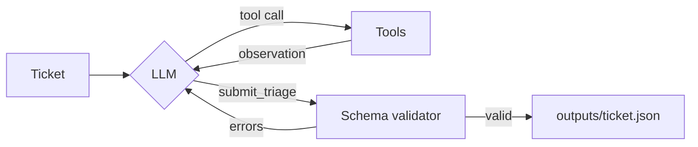

# 🎫 TAM Triage Agent

An agent that triages one support ticket the way a good TAM does: **who is this customer → how healthy is the account → what does the KB and policy say → decide**. The LLM chooses its own tools and decides when it has enough to stop.

 

## How it works



| Tool | Purpose |
|---|---|
| `resolve_account` | Fuzzy match on email domain + company name; flags **AMBIGUOUS** instead of guessing |
| `get_account_context` | Tier, renewal countdown, 12‑month usage trend, open escalations |
| `search_tickets` / `get_ticket` | Account‑scoped BM25 history → duplicate detection |
| `search_kb` | BM25 over ~390 articles; outdated ones are down‑ranked and flagged |
| `get_kb_article` | Full text; follow `superseded_by` and read support policy |
| `submit_triage` | Terminal call, validated against `schema.py`; errors are fed back to the model |

Depth adapts to the ticket: a vague free‑mail ticket needs **2** calls (resolve → ask for clarification); a security incident takes **7** (context, history, KB, policy search, policy read). Nothing large is ever pasted into a prompt, and ticket text is treated as untrusted (prompt injection is ignored and noted).

## Run it

```bash
python -m venv .venv && source .venv/bin/activate
pip install -r requirements.txt
cp .env.example .env                 # pick a provider + add its key
python scripts/validate_data.py
python run.py --set review           # writes outputs/ + run_log.jsonl
python scripts/check_outputs.py      # 10/10 valid
python -m ui.server                  # live UI → http://localhost:8000
```

Providers (`LLM_PROVIDER`): `groq`, `xai` (Grok), `openai`, `ollama`, or `mock` (offline, keyless, for tests).

## The UI

Pick a ticket, hit **Triage**, and watch the agent work: each tool call, its reasoning, and what it saw, streamed live. The side panel shows priority, routing, escalation / TAM / duplicate flags, an account health card, cited KB articles, and the drafted customer reply and internal note.

## Layout

```
tam_agent/  agent.py (loop) · tools.py (tools + BM25) · llm.py · schema.py · data.py · kb.py
ui/         server.py (SSE, stdlib) · index.html
scripts/    validate_data.py · check_outputs.py · gen_data.py
SOLUTION.md design · evaluation plan · scale · limitations
```
